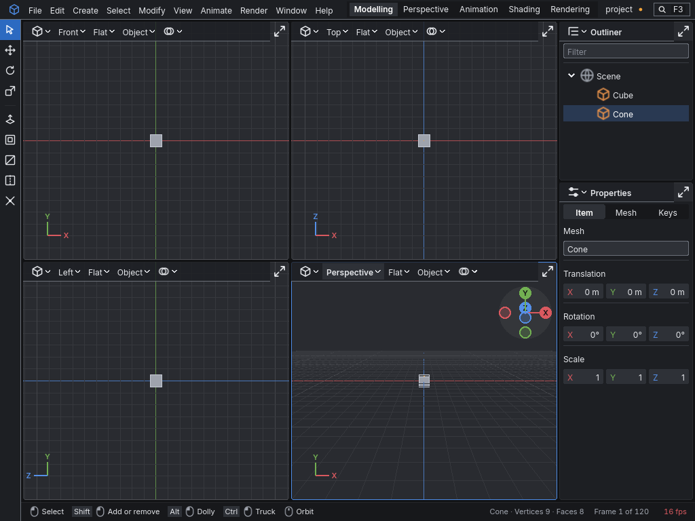
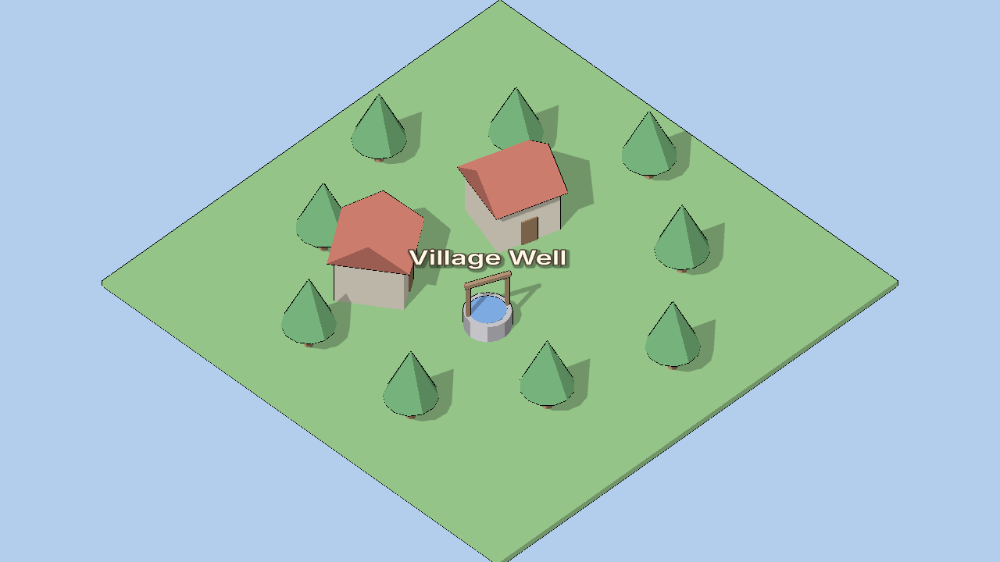
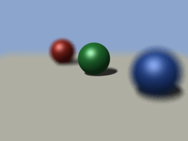
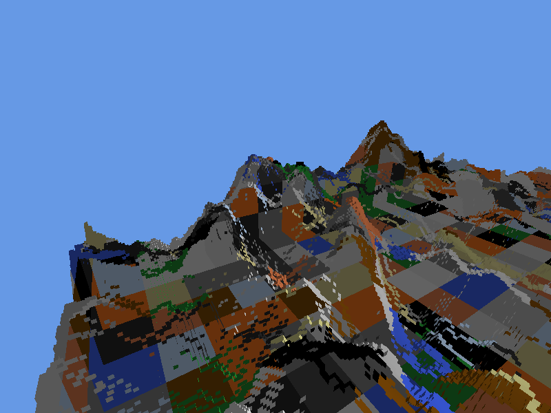
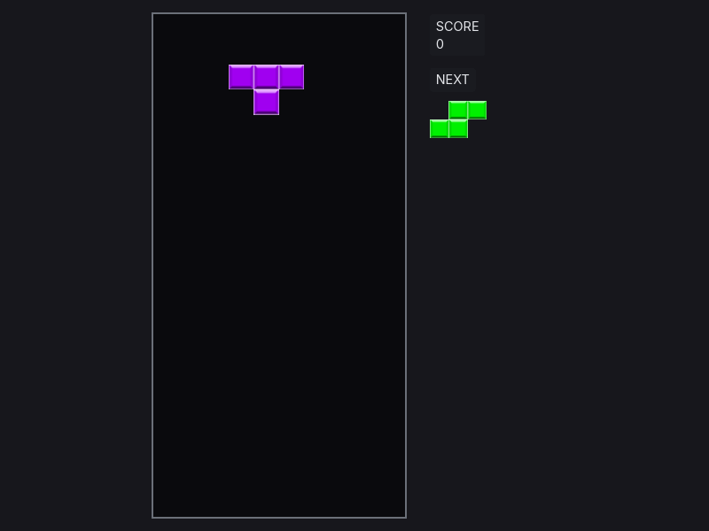
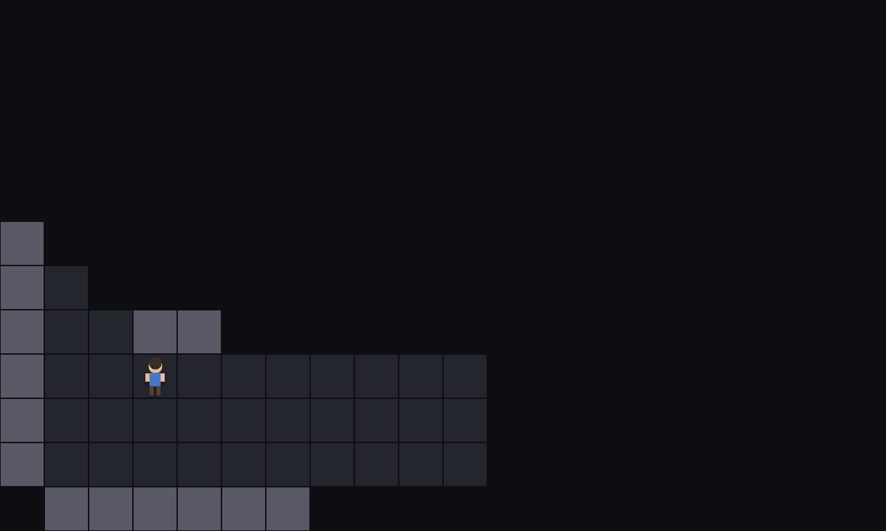

# Vertical3D

Vertical3D is a set of C++ libraries for building 3D applications and games, together with the
applications built on them. Rendering uses Vulkan 1.3, windowing and input use SDL3, and the
whole repository builds with CMake.

It builds on Windows with MSVC. Nothing is packaged or released; you build it from source.

| | | |
|---|---|---|
|  |  |  |
| The vertical3d editor | Diorama | moya |
|  |  |  |
| Voxel | Tetris | Odyssey |

`node scripts/pictures.ts` makes each of these from a scene or a script in the tree.

## The libraries

The libraries are in [api/](api/), one CMake target per directory.
[docs/api/README.md](docs/api/README.md#the-libraries) lists them, says what each is for, and
shows how they depend on each other.

## The applications

Each application builds with the libraries. vertical3d, moya and imagetool are top-level
directories. The five demos, voxel, pong, tetris, odyssey and diorama, are under [demos/](demos/).

| Application | What it is |
|---|---|
| **vertical3d** | A 3D modelling tool: four viewports over a construction grid, with polygon modelling, curves, cameras and lights, keyframe animation, TypeScript scripts, rendering with moya, and project files. The most complete app here |
| **voxel** | A Minecraft-style voxel terrain generator, with chunked meshes over Perlin noise |
| **pong** | Pong, with sound and a computer opponent |
| **tetris** | Tetris |
| **odyssey** | A tile-based roguelike in early development: a world of regions loaded as the player moves, routes and line of sight across them, and a player sprite |
| **diorama** | A lit village of glTF models with shadows under a moving sun, an isometric camera, and a looping sound placed at its well |
| **moya** | A RenderMan-style renderer. It reads a RIB file and renders it with a Reyes hider (micropolygon grids and buckets), or with ray tracing when the file says `Hider "raytrace"` |
| **imagetool** | A command-line tool for images. It prints an image's size, crops it and converts it, and it packs images into a sprite sheet and unpacks one |

[examples/](examples/) is separate: each example is its own CMake project that uses the
libraries the way an app in another repository would.

## Building

You need Windows, Visual Studio 2022 or newer, the Vulkan SDK and vcpkg.
[docs/contributing/GettingStarted.md](docs/contributing/GettingStarted.md) goes from a fresh
clone to a build, the tests and a running app.

## Documentation

The documents are published at [farrcraft.github.io/vertical3d](https://farrcraft.github.io/vertical3d/),
with an [API reference](https://farrcraft.github.io/vertical3d/reference/) built from the
headers. The same documents are in [docs/](docs/), and read the same here. Start with the ones
for what you are doing:

| You are | Read |
|---|---|
| Modelling with the editor | The [editor manual](docs/manual/editor/README.md), starting with its tutorial |
| Rendering with moya | The [moya manual](docs/manual/moya/README.md), starting with its tutorial |
| Contributing to this repository | [docs/contributing/](docs/contributing/), starting with [GettingStarted.md](docs/contributing/GettingStarted.md) |
| Writing an app with the libraries | [docs/api/](docs/api/), and [UsingTheApi.md](docs/api/UsingTheApi.md) for an app in another repository |
| Changing the renderer or the UI library | [docs/internals/](docs/internals/) |
| Working on moya or the offline renderer | [docs/offline/](docs/offline/README.md) |
| Working on the vertical3d editor | [docs/editor/](docs/editor/README.md) |
| Working on a demo | [docs/Demos.md](docs/Demos.md) |
| Working on imagetool | [docs/Imagetool.md](docs/Imagetool.md) |
| Reading an example | [examples/README.md](examples/README.md) |
| Asking why something is designed as it is | [docs/adr/](docs/adr/), the architecture decision records |

[docs/README.md](docs/README.md) indexes every document. [CLAUDE.md](CLAUDE.md) is orientation
for coding agents.

## License

Vertical3D is under the MIT license, in [LICENSE](LICENSE). The third-party code it carries keeps
its own license, and LICENSE lists each one.
