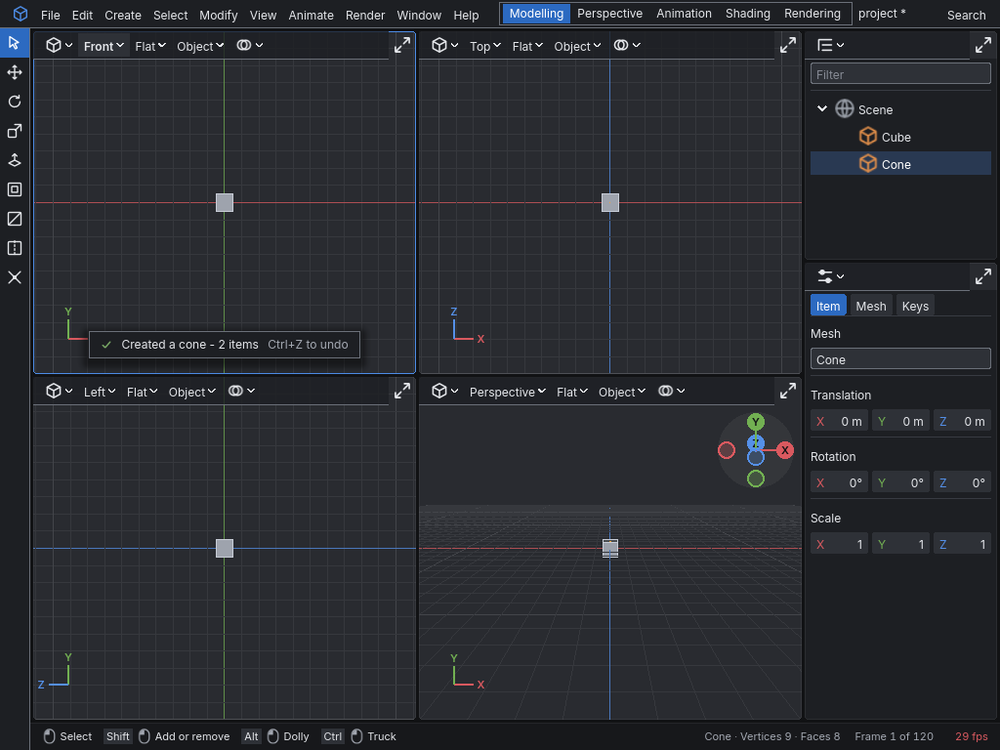

# Tutorial: a first scene

In this tutorial you make a scene with a cube and a cone, move the cone, undo and redo the move,
look at the scene from different views, and save it as a project. Then you close the editor and
open the project again. It takes about fifteen minutes.

You need a built copy of the editor. [README.md](README.md#starting-the-editor) says where it
is.

## Start the editor

1. Run `vertical3d.exe`.
2. If a box asks "Recover the unsaved changes to project?", click **Discard**.
3. In the bar at the top of the window, click the **Modelling** tab.

The window shows four viewports: Front at the top left, Top at the top right, Left at the
bottom left, and Perspective at the bottom right. Down the right side is the outliner, with the
properties editor below it. The caption reads `Vertical|3D - project - frame 1`.

## Create a project

1. Choose **File > Save As**.
2. A file chooser opens. Click the box that shows `name`, and type `first-scene`.
3. Click **Accept**.

The caption now reads `Vertical|3D - first-scene - frame 1`. The editor made a directory named
`first-scene` in the `Vertical3D` folder in your documents, and saved the empty scene into it.

## Add a cube and a cone

1. Choose **Create > Poly > Cube**.
2. Move the cursor over the Perspective view, and press **4**.

A cube and a cone appear at the centre of the grid, one inside the other. The outliner lists
them as `Cube` and `Cone`. A notice at the foot of the view says each one was created.

*Captured by `node scripts/pictures.ts`, which starts the editor with
[scenes/first-scene.ts](scenes/first-scene.ts) and `--capture`.*

## Select the cone

1. Click an empty part of the Perspective view, away from both shapes. Nothing is selected now.
2. In the outliner, click the row named `Cone`.

The cone is drawn in amber. The properties editor shows its name and its values.

## Move the cone

1. Press **W**. This chooses the Move manipulator. An arrow for each axis appears at the cone's
   centre: red for X, green for Y and blue for Z.
2. Move the cursor over the Front view.
3. Press the left mouse button on the red arrow, drag to the side, and let go.

The cone slides along the X axis, clear of the cube. In the properties editor, the X field under
Translation shows its new position.

## Undo and redo

1. Press **Ctrl+Z**. The cone goes back inside the cube.
2. Press **Ctrl+Y**. The cone moves out again.

## Look through the viewports

1. Move the cursor over the Perspective view.
2. Hold the middle mouse button and drag. The view orbits around the scene.
3. Hold **Left Alt**, then drag with the left mouse button. The view moves nearer or further.
4. Hold **Left Ctrl**, then drag with the left mouse button. The view slides sideways.
5. Press **Ctrl+Space**. The Perspective view takes the room of all four views.
6. Press **Ctrl+Space** again. The four views come back.
7. Move the cursor over the Top view, and press **P**. The Top view now shows perspective.
   Press **P** again to make it orthographic again.

## Save and close

1. Press **Ctrl+S**. The ` *` at the end of the project's name in the caption goes away.
2. Choose **File > Quit**. The editor closes without asking, because nothing is left unsaved.

## Open the project again

1. Run `vertical3d.exe`. It starts with an empty scene in the default project.
2. Press **Ctrl+O**. The file chooser opens.
3. In the list, click `first-scene` to open that directory.
4. Click `project.json`, then click **Accept**.

The cube and the cone are back where you saved them, and the caption names `first-scene`.

## Next

The how-to guides in [README.md](README.md#the-pages) cover each task in detail.
[Modelling.md](Modelling.md) is a good one to read next.
