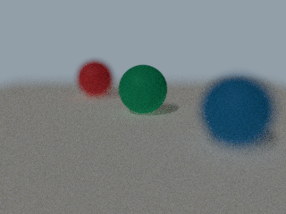

# Place the camera, and add depth of field and motion blur

## Place the camera

The camera sits at the origin of camera space and looks along +z. +x is to the right and +y is
up. The transformation requests before `WorldBegin` move the scene in front of the camera:

```
Rotate -12 1 0 0
Translate 0 -1.4 5.5
WorldBegin
```

moya applies the requests to each point of the scene in the opposite order to the file, the
last first. Here the scene moves 1.4 units down and 5.5 units away from the camera, and then
tilts up by 12 degrees about x. The effect is a camera above and in front of the scene, looking
down at it.

- `Rotate` takes an angle in degrees and an axis. A positive angle about y turns +z toward +x.
  A positive angle about x turns +z toward -y.
- `Transform` replaces the transformation with a 4 by 4 matrix, and `ConcatTransform` applies one
  before the current transformation. A matrix is 16 numbers, row by row. A point is a row vector
  on the left of the matrix, so the last row holds the translation.
- `Identity` resets the transformation.

## Choose the projection

```
Projection "perspective" "fov" [40]
Clipping 0.1 100
```

- `Projection "perspective"` gives a perspective camera. `"fov"` is its field of view in degrees.
  With the default screen window it spans the shorter side of the picture. It is 90 if you leave
  it out.
- `Projection "orthographic"` gives a camera with parallel rays and no perspective.
- **A scene with no `Projection` is orthographic.** Name the perspective projection when you
  want it.
- `Clipping near far` draws only what lies between the two distances from the camera. The
  default is 1e-10 to 1e38.
- `ScreenWindow left right bottom top` sets the part of the projection the picture shows. The
  default for a picture wider than tall is -a to a across and -1 to 1 down, where a is the
  width divided by the height. For a taller picture it is -1 to 1 across and -1/a to 1/a
  down. An orthographic camera shows that region in camera space units.
- `FrameAspectRatio` sets the shape of the frame, independently of `Format`.

Every camera request takes effect at `WorldBegin`, in any order. Put them all before it.

## Add depth of field

Depth of field blurs what lies nearer or further than one distance from the camera.

```
Format 160 120 1
PixelSamples 8 8
Projection "perspective" "fov" [40]
Clipping 0.1 100
DepthOfField 2 0.5 4
WorldBegin
Surface "constant"
Color [0.9 0.2 0.2]
Polygon "P" [-1.5 -1 4  -0.2 -1 4  -0.2 1 4  -1.5 1 4]
Color [0.2 0.4 0.9]
Polygon "P" [0.5 -2.5 10  4 -2.5 10  4 2.5 10  0.5 2.5 10]
WorldEnd
```

The red quad, four units away, is sharp. The blue quad, ten units away, is blurred.



*[scenes/focus.rib](scenes/focus.rib): a lens radius of 0.36, focused on the middle sphere,
rendered by `node scripts/pictures.ts`.*

- `DepthOfField fstop focallength focaldistance` sets the lens. Objects at `focaldistance` from
  the camera are sharp.
- The lens radius is `focallength / (2 * fstop)`, in camera space units. A larger radius blurs
  more. Here it is 0.125.
- `DepthOfField` with no arguments, an fstop of zero, or a focal length of zero is a pinhole
  camera, with no blur.
- Only a perspective camera blurs. An orthographic camera ignores `DepthOfField`.
- Each sample of a pixel looks through a different point of the lens. Raise `PixelSamples`
  ([Quality.md](Quality.md)) to make the blur smooth rather than grainy.

## Add motion blur

Motion blur smears an object along the path it moves while the shutter is open. Set the shutter,
then give the transformation at the start and the end of the motion:

```
Format 160 120 1
PixelSamples 8 8
Shutter 0 1
Projection "perspective" "fov" [40]
Clipping 0.1 100
WorldBegin
Surface "constant"
AttributeBegin
MotionBegin [0 1]
Translate -1 0 5
Translate 1 0 5
MotionEnd
Color [0.9 0.8 0.2]
Polygon "P" [-0.4 -0.4 0  0.4 -0.4 0  0.4 0.4 0  -0.4 0.4 0]
AttributeEnd
WorldEnd
```

The yellow quad is smeared from left to right.

- `Shutter open close` sets when the shutter opens and closes. The default, `0 0`, gives no blur.
- `MotionBegin` lists the times, and holds one transformation request for each time. Each request
  applies to the transformation as it stood at `MotionBegin`, so here the quad is at x = -1 when
  the shutter opens and at x = 1 when it closes.
- A block may list more than two times. The object passes through the transformation given for
  each, in order. The times have to rise. A block whose times do not rise is logged, and keeps
  its first time alone.
- Between two times, moya moves and scales the object in a straight line and turns it the
  shortest way at an even rate.
- Requests after `MotionEnd` apply at every time, so what follows the block moves with it.
- A motion block before `WorldBegin` moves the camera.
- Each pixel's samples fall at different times in the shutter. Raise `PixelSamples` to make the
  smear smooth. Shadows and reflections blur with the object.

### Change an object's shape

A primitive given once for each time inside a motion block changes its shape over the shutter:

```
MotionBegin [0 1]
Polygon "P" [-0.4 -0.4 5  0.4 -0.4 5  0.4 0.4 5  -0.4 0.4 5]
Polygon "P" [-0.4 -0.4 5  0.4 -0.4 5  0.8 0.8 5  -0.8 0.8 5]
MotionEnd
```

- moya moves each point in a straight line between its positions.
- Each later primitive has to have as many points as the first. One that does not is logged, and
  the object keeps the first shape.
