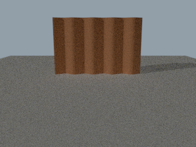

# Displace a subdivision surface

A displacement moves the points of a surface before it is rendered. It can add ripples, bumps or
grooves to a smooth surface. Shading, shadows and reflections all follow the moved shape.

moya displaces subdivision surfaces alone. A polygon, a sphere or a curve is drawn where its
points put it, whatever displacement it is given. To displace a flat panel, make it a
`SubdivisionMesh`, as the example here does.

A displacement is a MaterialX graph. RI's `Displacement` request names one by a document on the
shader search path, as `Surface` names a surface of your own. A material read by a `Bxdf` of type
`materialx` can carry its own displacement instead.

## 1. Write the document

When a scene names `Displacement "ripple"`, moya reads `ripple.mtlx` from the shader search
path. [scenes/shaders/ripple.mtlx](scenes/shaders/ripple.mtlx) moves a surface along its normal
by a sine wave across x:

```xml
<nodedef name="ND_ri_ripple_displacementshader" node="ri_ripple" nodegroup="pbr">
  <input name="height" type="float" value="0.05" />
  <input name="frequency" type="float" value="10" />
  <output name="out" type="displacementshader" />
</nodedef>
<nodegraph name="NG_ri_ripple_displacementshader" nodedef="ND_ri_ripple_displacementshader">
  <position name="where" type="vector3" />
  <extract name="x" type="float">
    <input name="in" type="vector3" nodename="where" />
    <input name="index" type="integer" value="0" />
  </extract>
  <multiply name="phase" type="float">
    <input name="in1" type="float" nodename="x" />
    <input name="in2" type="float" interfacename="frequency" />
  </multiply>
  <sin name="wave" type="float">
    <input name="in" type="float" nodename="phase" />
  </sin>
  <multiply name="lift" type="float">
    <input name="in1" type="float" nodename="wave" />
    <input name="in2" type="float" interfacename="height" />
  </multiply>
  <displacement name="moved" type="displacementshader">
    <input name="displacement" type="float" nodename="lift" />
  </displacement>
  <output name="out" type="displacementshader" nodename="moved" />
</nodegraph>
```

- **The definition is named `ND_ri_<name>_displacementshader`**, and its output is of type
  `displacementshader`. Its inputs are the displacement's parameters, each with its type and
  default.
- **The node graph implements it**, and ends in MaterialX's `displacement` node.
- **A float displacement moves a point along its normal.** A `vector3` displacement moves it
  along the surface's tangent, bitangent and normal, in that order.
- **`position` gives the point in the surface's own space**, before it moves. The wave here
  follows x in that space, so it does not change when the object is moved.
- **The graph can read the texture coordinates, a primvar, a noise or an image**, as a surface's
  graph can. [Materials.md](Materials.md#what-a-graph-can-hold) lists what it can hold.

The search path is set as [Materials.md](Materials.md#1-tell-moya-where-the-documents-are)
describes.

## 2. Use it

```
Format 320 240 1
PixelSamples 8 8
Projection "perspective" "fov" [40]
Option "searchpath" "shader" ["C:/renders/shaders:&"]
Rotate -12 1 0 0
Translate 0 -1.4 5.5
WorldBegin
LightSource "ambientlight" 1 "intensity" [0.2]
LightSource "distantlight" 2 "intensity" [0.9] "to" [1 -0.4 0.5]
Color [0.85 0.55 0.3]
Surface "plastic" "Ks" [0.4] "roughness" [0.1]
Attribute "displacementbound" "float sphere" [0.1]
Displacement "ripple" "float height" [0.08] "float frequency" [10]
SubdivisionMesh "catmull-clark" [4] [0 1 2 3] ["interpolateboundary"] [0 0] [] []
    "P" [-1.4 0 1  1.4 0 1  1.4 1.8 1  -1.4 1.8 1]
WorldEnd
```

The panel is one face whose boundary is interpolated, so it is flat until it is displaced. It
shows vertical ridges, lit on one slope and shaded on the other.



*[scenes/ripple.rib](scenes/ripple.rib), the same panel on a floor, rendered by
`node scripts/pictures.ts`.*

- `Displacement` names the displacement for the objects that follow, as `Surface` does.
- Give each parameter its type, as in `"float height"`. A parameter with no type is skipped with
  a warning, and the displacement uses its default.
- A positive height moves the surface toward its front, the side its corners wind
  counterclockwise as you look at it.
- A name that no document on the path defines is logged once, and the surface is not displaced.

## 3. Set the displacement bound

`Attribute "displacementbound"` sets how far the displacement may move a point. **Without it,
nothing moves.** Set it to the largest distance the displacement moves anything:

```
Attribute "displacementbound" "float sphere" [0.1]
```

- A point the displacement moves further than the bound stops at the bound, and the log says so.
- The distance is in object space. Add `"string coordinatesystem" ["world"]` to give it in world
  space instead. A name the scene saved with `CoordinateSystem` also works. Any other name is
  logged, and object space is used.
- A distance below zero is logged and not used.
- The bound applies to the subdivision surfaces after it in its attribute block.

## How finely a surface is cut

moya cuts a subdivision surface into triangles before it displaces them. Each edge of the
control mesh is cut into pieces about one pixel long on the screen, and into at most 64 pieces.
A displacement shows no detail finer than those pieces.

- A large face close to the camera reaches 64 pieces along each edge. Give the control mesh more
  faces to show finer detail on it.
- A surface placed many times is cut once, for the placement nearest the camera.
