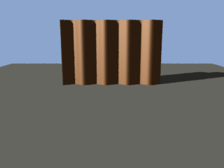

# Move a surface with a displacement shader

A displacement shader moves the points of a surface before the surface shader runs. It can add
ripples, bumps or grooves to a flat polygon. The surface shader then shades the moved surface,
and shadows and reflections follow its moved shape.

## 1. Write the shader

Save this as `ripple.sl` in a shader directory, such as `C:\renders\shaders`:

```
/* Moves the surface along its normal by a sine wave across x in shader space. */
displacement ripple(float height = 0.05; float frequency = 10) {
    point Pshader = ptransform("shader", P);
    P += height * sin(frequency * xcomp(Pshader)) * normalize(N);
    N = calculatenormal(P);
}
```

- A displacement shader writes `P`, the position, and `N`, the normal.
- It can read `Ng`, `I`, `E`, `s`, `t`, `u`, `v`, `du` and `dv`. It cannot read the surface's
  colour or anything a surface shader writes.
- `calculatenormal(P)` finds the normal of the moved surface. Without that line, the surface
  moves but is shaded as if it were flat.
- The wave follows the position in the shader's own space, not `s`. A large polygon can be split
  into pieces that each have their own `s`, and a pattern in `s` would not join across them.

## 2. Use it

```
Hider "raytrace"
Format 160 120 1
Projection "perspective" "fov" [40]
Option "searchpath" "shader" ["C:/renders/shaders:&"]
WorldBegin
LightSource "ambientlight" 1 "intensity" [0.1]
LightSource "distantlight" 2 "to" [1 0 1]
Color [0.8 0.8 0.85]
Surface "matte"
Attribute "displacementbound" "float sphere" [0.1]
Displacement "ripple" "float height" [-0.1] "float frequency" [8]
Polygon "P" [-1.5 -1 5  1.5 -1 5  1.5 1 5  -1.5 1 5]
WorldEnd
```

The quad shows vertical ripples, lit on one slope and shaded on the other. The quad's normal
points away from the camera, so a negative `height` moves it toward the camera.



*[scenes/ripple.rib](scenes/ripple.rib): the same shader on a panel lit from the left, rendered by
`node scripts/pictures.ts`.*

`Displacement` names the shader for the surfaces that follow, as `Surface` does. `Option
"searchpath"` is described in [Shaders.md](Shaders.md#2-tell-moya-where-the-shader-is).

## 3. Set the displacement bound

`Attribute "displacementbound"` tells moya how far the shader can move a point. Set it to the
largest distance the shader moves anything:

```
Attribute "displacementbound" "float sphere" [0.1]
```

- moya uses the bound to decide which part of the picture a surface can reach. A surface the
  shader moves further than its bound can be cut off at the bound's edge.
- Without a bound, moya works out where a surface can reach from its shape before it moves.
- The distance is in object space. Add `"string coordinatesystem" ["world"]` to give it in world
  space instead. `"camera"`, and any name the scene saved with `CoordinateSystem`, also work. A
  name moya does not recognise is logged, and object space is used.

## How each hider displaces

- **The reyes hider** runs the shader on each grid it dices. The grid is as fine as the shading
  rate sets ([Quality.md](Quality.md#shading-rate-reyes)).
- **The ray-trace hider** dices each displaced polygon into a grid of 64 by 64 squares, runs the
  shader once on it, and traces the result as flat triangles. Detail finer than that grid is
  lost.
- Under either hider, shadows and reflections meet the displaced shape. The shader runs once,
  so a displacement that changes over the shutter does not blur.
- A sphere is never displaced.
