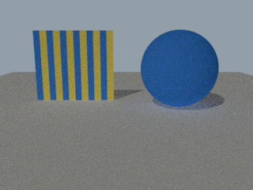

# Give a surface a material

A material says how a surface reflects, transmits and emits light. Every material in moya is a
MaterialX material, and most are OpenPBR Surface, a layered model of base, specular, coat and
transmission. A scene names a material in one of three ways:

- `Surface` with one of RI's surfaces, such as `matte` or `plastic`. moya defines these.
- `Surface` with a name of your own, defined in a MaterialX document on the shader search path.
- RenderMan's `Bxdf` and `Pattern`, which name MaterialX nodes directly.

A material belongs to the geometry that follows it, until the attribute block ends or another
material is named. A surface with no material is `matte`, in white unless `Color` gives another
colour.

## RI's surfaces

```
Color [0.85 0.2 0.15]
Surface "plastic" "Ks" [0.6] "roughness" [0.05]
```

`Surface` names the surface, and its parameters follow. A parameter left out keeps its default.

| Surface | Parameters and defaults | The material |
|---|---|---|
| `matte` | `Ka` 1, `Kd` 1 | A diffuse base of weight `Kd` in the colour |
| `plastic` | `Ka` 1, `Kd` 0.5, `Ks` 0.5, `roughness` 0.1, `specularcolor` `[1 1 1]` | A diffuse base of weight `Kd` in the colour, under a clear specular layer of weight `Ks` in `specularcolor` |
| `paintedplastic` | As `plastic`, and `texturename` `""` | `plastic`, with the colour multiplied by the image `texturename` names. See [Textures.md](Textures.md) |
| `metal` | `Ka` 1, `Ks` 1, `roughness` 0.1 | A metal of the colour, of weight `Ks` |
| `shinymetal` | `Ka` 1, `Ks` 1, `Kr` 1, `roughness` 0.1 | `metal` with a mirror of weight `Kr` added. The weight is `Ks` and `Kr` together, at most 1 |
| `glass` | `Ka` 0, `Ks` 0.5, `Kr` 1, `Kt` 1, `roughness` 0.05, `eta` 1.5 | Smooth glass. It reflects with weight `Kr`, transmits `Kt` in the colour, and bends light by the index `eta` |
| `constant` | None | Emits the colour, and reflects nothing |

- **The colour is `Color`**, or a `"Cs"` the geometry gives at each vertex. `constant` takes
  `Color` alone.
- **`roughness` is RI's**, where a small value gives a small, sharp highlight. 0.1 is a broad
  highlight, and 0.01 a tight one. `glass` is always sharp, and reads neither `roughness` nor `Ks`.
- **`Ka` is read and not used.** The ambient light lights a surface as every other light does.
- **RI's weights add up, and OpenPBR's layers share the light.** A material is close to RI's
  surface, not equal to it. A `plastic` whose `Kd` and `Ks` add up to more than 1 still reflects
  no more light than reaches it.
- **`constant` glows.** Its light falls on the rest of the scene, as an area light's does. `Sides
  1` makes it glow from its front face alone, and the default, `Sides 2`, from both faces.
- **`Kt` and `eta` need a type**, as in `"float eta" [1.33]`. `Ka`, `Kd`, `Ks`, `Kr`,
  `roughness`, `specularcolor` and `texturename` have a type already.

### Opacity

`Opacity [r g b]` sets how much of a surface is there. moya takes the mean of the three values.

- **An opacity below 1 cuts the surface out.** A ray passes through it with a chance of one
  less the opacity, so `Opacity [0.3 0.3 0.3]` shows the surface at 30 percent.
- **A shadow passes one less the opacity** of each surface it crosses.
- **The opacity is one value over the surface.** A `"Os"` the geometry gives at each vertex is
  not read.
- **`glass` is never cut out.** It lets light through by its transmission.

## A surface of your own

A surface of your own is a MaterialX document named after it, in a directory on the shader
search path. When a scene names `Surface "stripes"`, moya reads `stripes.mtlx`.
[scenes/shaders/stripes.mtlx](scenes/shaders/stripes.mtlx) is the worked example here. It is a
matte surface in stripes of two colours.

### 1. Tell moya where the documents are

Set the shader search path before `WorldBegin`:

```
Option "searchpath" "shader" ["C:/renders/shaders:&"]
```

- The path is a list of directories, separated by colons. `&` stands for the path as it was
  before, so the line above adds a directory without removing any.
- A single letter before a colon is a drive letter, so `C:/renders/shaders` is one directory.
- Write `/` between directories. A backslash in a RIB string starts an escape.
- A relative directory is read from the folder you run moya from. Give full paths to use the
  same documents from anywhere.
- moya reads the document from the first directory on the path that holds one. A document on the
  path takes the place of RI's surface of the same name.

### 2. Write the document

The document holds three things, named after the surface:

- **`ND_ri_<name>_surfaceshader`**, a node definition. Its inputs are the surface's parameters,
  each with its type and default, and `Cs` and `Os` of type `color3`. Its output is `out`, of type
  `surfaceshader`.
- **`ND_ri_<name>_to_open_pbr_surface`**, a second node definition of `nodegroup`
  `translation`. It takes the same inputs. Its outputs are the OpenPBR inputs the surface sets,
  each named with `_out` after it, such as `base_color_out`. An OpenPBR input with no output
  keeps OpenPBR's default.
- **`NG_ri_<name>_to_open_pbr_surface`**, a node graph that implements the second definition.
  It works out each output from the inputs.

The stripes surface's first definition:

```xml
<nodedef name="ND_ri_stripes_surfaceshader" node="ri_stripes" nodegroup="pbr">
  <input name="Ka" type="float" value="1" />
  <input name="Kd" type="float" value="1" />
  <input name="frequency" type="float" value="8" />
  <input name="stripecolor" type="color3" value="1, 1, 1" />
  <input name="Cs" type="color3" value="1, 1, 1" />
  <input name="Os" type="color3" value="1, 1, 1" />
  <output name="out" type="surfaceshader" />
</nodedef>
```

Its translation sets four outputs: `base_weight_out`, `base_color_out`, `specular_weight_out` and
`geometry_opacity_out`. The graph passes `Kd` to the base weight and 0 to the specular weight,
which leaves a matte surface. The stripes are worked out from `s`, the first texture coordinate:

```xml
<texcoord name="st" type="vector2" />
<extract name="s" type="float">
  <input name="in" type="vector2" nodename="st" />
  <input name="index" type="integer" value="0" />
</extract>
<multiply name="across" type="float">
  <input name="in1" type="float" nodename="s" />
  <input name="in2" type="float" interfacename="frequency" />
</multiply>
<fract name="within" type="float">
  <input name="in" type="float" nodename="across" />
</fract>
<multiply name="halves" type="float">
  <input name="in1" type="float" nodename="within" />
  <input name="in2" type="float" value="2" />
</multiply>
<floor name="band" type="float">
  <input name="in" type="float" nodename="halves" />
</floor>
<mix name="stripes" type="color3">
  <input name="fg" type="color3" interfacename="stripecolor" />
  <input name="bg" type="color3" nodename="colour" />
  <input name="mix" type="float" nodename="band" />
</mix>
```

- `band` is 0 in the first half of each stripe and 1 in the second, and `mix` picks the surface
  colour or `stripecolor` by it.
- `colour` is a `geompropvalue` node that reads the geometry's `Cs`, with the `Cs` input as its
  default. A surface then takes a `"Cs"` given at each vertex, and `Color` otherwise.
- `interfacename` connects a node's input to an input of the definition.
- The opacity is the mean of `Os`, worked out by three `extract` nodes, two `add` nodes and a
  `multiply`.

### 3. Use the surface

Name it with `Surface`, and give each parameter its type:

```
Format 320 240 1
Projection "perspective" "fov" [40]
Option "searchpath" "shader" ["C:/renders/shaders:&"]
WorldBegin
LightSource "ambientlight" 1 "intensity" [0.2]
LightSource "distantlight" 2 "to" [0.3 -0.5 1]
Color [0.2 0.3 0.8]
Surface "stripes" "float frequency" [6] "color stripecolor" [1 0.9 0.2]
Polygon "P" [-1.5 -1 5  1.5 -1 5  1.5 1 5  -1.5 1 5] "st" [0 1  1 1  1 0  0 0]
WorldEnd
```

The panel shows six yellow and six blue stripes, running up it.



*[scenes/stripes.rib](scenes/stripes.rib), with the shader search path set to
[scenes/shaders](scenes/shaders), rendered by `node scripts/pictures.ts`.*

- **Give each parameter its type**, as in `"float frequency"`. A parameter with no type is
  skipped with a warning, and the surface uses its default. `Declare "frequency" "float"` before
  the request gives the type once for the rest of the file.
- **A parameter the definition does not take** is reported, and changes nothing.
- **`Color` reaches the `Cs` input, and `Opacity` the `Os` input.**
- **Give a polygon `"st"`** when a surface reads the texture coordinates. A surface without it,
  and every sphere and other quadric, reads `s` and `t` as 0, so the stripes do not show.

### What a graph can hold

The graph can use MaterialX's standard nodes: maths, mixing, comparisons, the texture
coordinates, a primvar by name, positions and normals, noises and other patterns, and images. A
node moya cannot run gives its output's default, and the log names it.

- **What a surface emits is one value over the surface.** An emission input that a pattern or an
  image feeds gives its default, and the log says so.
- **A document MaterialX cannot read** is reported in the log.

## When moya cannot find a surface

A surface that no document on the path defines, and that is not one of RI's, shades as `matte`.
The log names it once, however often the scene uses it. A surface written for another renderer,
such as a compiled shader, is such a surface.

## RenderMan's Bxdf and Pattern

`Bxdf` and `Pattern` build a material from MaterialX nodes, as RenderMan's RIB writes a shading
network. Each names a node definition, a handle, and the node's inputs:

```
Pattern "ND_constant_color3" "tint" "color value" [0.9 0.6 0.2]
Bxdf "ND_open_pbr_surface_surfaceshader" "gold" "reference color base_color" ["tint:out"]
    "float base_metalness" [1] "float specular_roughness" [0.3]
Sphere 0.6 -0.6 0.6 360
```

- **`Pattern` adds a node.** Its first argument is a MaterialX node definition, such as
  `ND_image_color3` or `ND_noise2d_float`. Its second is the handle other nodes name it by.
- **`Bxdf` adds the surface node.** The last `Bxdf` is the material's surface. It can be
  `ND_open_pbr_surface_surfaceshader`, `ND_standard_surface_surfaceshader`,
  `ND_UsdPreviewSurface_surfaceshader` or `ND_gltf_pbr_surfaceshader`. moya renders the last three
  as OpenPBR.
- **`reference` connects an input to another node's output.** Its value is the handle, a colon
  and the output's name, as in `"tint:out"`, or the handle alone for a node of one output. The
  node it names has to come before it.
- **Each other parameter is a constant input**, typed in its name, such as `"float
  specular_roughness"`.
- **The network belongs to the attribute block.** `AttributeEnd` restores the network as it was
  at `AttributeBegin`.
- **The later of `Surface` and `Bxdf` shades what follows.** `Surface` clears the network.
- **`Color` and `Opacity` do not reach a `Bxdf`.** Set its colour and opacity through its own
  inputs, such as `base_color` and `geometry_opacity`.
- **An input the definition does not take, or a node definition MaterialX does not hold**, is
  reported and left out.

### A material from a MaterialX document

A `Bxdf` of type `materialx` reads a whole material from a document:

```
Bxdf "materialx" "painted" "string file" ["C:/renders/painted.mtlx"] "string material" ["painted"]
    "float specular_roughness" [0.6]
```

- `file` names the document. A relative path is read from the folder you run moya from.
- `material` names the material node in it. Without it, moya takes the document's first
  material.
- The `Bxdf`'s other parameters replace the surface node's inputs.
- An image the document names by a relative path is read from the document's directory.
- A material whose `displacementshader` names a node displaces the surface, as
  [Displacement.md](Displacement.md) describes.
- A document moya cannot read, or one without the material, is reported. The surface is then the
  one `Surface` names.
