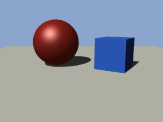

# Render a first scene

This tutorial renders [first.rib](first.rib), a small scene beside this page. It holds a camera,
two lights, a floor, a sphere and a box. You run moya on it and open the image it writes. It
takes a few minutes.

You need a build of the repository. [README.md](README.md#getting-moya) says where `moya.exe` is.

## 1. Read the scene

Open [first.rib](first.rib) in a text editor. A RIB file is plain text. Each line starts with the
name of a request, such as `Format` or `Polygon`, and its arguments follow. A line that starts
with `#` is a comment.

The file has two parts. Everything before `WorldBegin` sets up the picture and the camera.
Everything between `WorldBegin` and `WorldEnd` is the scene.

The first part:

```
Hider "raytrace"
Format 320 240 1
Display "first.png" "file" "rgb"
Projection "perspective" "fov" [40]
Clipping 0.1 100
Imager "background" "background" [0.55 0.65 0.8]
Rotate -12 1 0 0
Translate 0 -1.4 5.5
```

- `Hider "raytrace"` renders by tracing rays. The hider is the part of moya that works out what
  the camera sees. [Hiders.md](Hiders.md) compares the two hiders.
- `Format 320 240 1` makes the picture 320 pixels wide and 240 high, with square pixels.
- `Display` names the file moya writes, `first.png`.
- `Projection "perspective" "fov" [40]` gives a perspective camera with a 40 degree field of view.
- `Clipping 0.1 100` draws only what lies between 0.1 and 100 units from the camera.
- `Imager "background"` paints a pale blue behind everything the scene does not cover.
- `Rotate` and `Translate` place the camera. moya applies them to the scene, last request first.
  The scene moves 1.4 units down and 5.5 units away, and then tilts up by 12 degrees. The camera
  therefore sees it from above and in front.

The camera looks along +z. +x is to the right and +y is up.

The second part creates the lights, then three objects:

```
LightSource "ambientlight" 1 "intensity" [0.2]
LightSource "distantlight" 2 "intensity" [0.9] "to" [0.5 -1 0.8]
```

The ambient light lights every surface evenly, so no part of the scene is fully black. The
distant light shines in one direction, like the sun. Its light travels toward `to`: to the
right, down and away from the camera. The number after each light's name is its handle, which
other requests use to switch the light on or off.

Each object sits in an `AttributeBegin` and `AttributeEnd` block. A block keeps its colour,
shader and position to itself:

```
AttributeBegin
Color [0.85 0.2 0.15]
Surface "plastic" "Ks" [0.6] "roughness" [0.05]
Translate -0.9 0.8 0.5
Sphere 0.8 -0.8 0.8 360
AttributeEnd
```

`Color` sets the surface colour, as red, green and blue from 0 to 1. `Surface` chooses the
surface shader, here the built-in `plastic`, and sets two of its parameters. `Translate` moves
the sphere. `Sphere` draws a sphere of radius 0.8, cut at heights -0.8 and 0.8, swept through
the full 360 degrees.

The floor is one `Polygon` with four corners. The box is a `PointsPolygons`: a list of six faces,
each a list of indices into one shared list of corner points.

## 2. Run moya

Open a command prompt and change to the directory that holds `moya.exe`. moya must be started
from its own directory. Started anywhere else, Windows cannot find the libraries moya needs and
shows an error dialog.

```
cd C:\code\vertical3d\out\build\x64-Debug\moya
moya.exe --file C:\code\vertical3d\docs\manual\moya\first.rib --output C:\renders\first.png
```

Change the paths to match where the repository is, and make the `C:\renders` directory first or
choose another. Give full paths. A relative path is read from moya's own directory.

`--output` names the file to write, and replaces the file the scene's `Display` names. Without
it, moya writes `first.png` into its own directory.

moya prints a copyright notice and the name of the scene, then renders. A Debug build takes a
few seconds on this scene. When the command prompt returns, the picture is written.

## 3. Open the image

Open `C:\renders\first.png` in any image viewer. You see a red sphere and a blue box on a pale
floor, against a pale blue sky. Each object casts a shadow to the right and away from the camera.



*`first.rib`, rendered by `node scripts/pictures.ts`.*

## 4. Check the log

moya writes its messages to `v3d.log`, in its own directory. Open it and read the last lines.
A good render ends with a line like this:

```
[info] rendered 320 by 240 pixels in 5.570 s
```

A problem in the scene, such as a shader moya cannot find, is a `[warning]` or an `[error]` line
above it. moya still writes a picture when a scene has such a problem, so check the log whenever
a picture looks wrong.

## 5. Change something

Edit a copy of the scene and render it again:

- Change the sphere's `Color` to `[0.2 0.7 0.3]` for a green sphere.
- Change the box's `Surface "matte"` to `Surface "metal"` for a metal box.
- Change `"to" [0.5 -1 0.8]` to `"to" [-0.5 -1 0.8]` to light the scene from the other side.
- Change `Hider "raytrace"` to `Hider "hidden"`. The sphere disappears, because the reyes hider
  does not draw spheres. The log says so.

## Where to go next

- [Shaders.md](Shaders.md) writes a surface shader of your own.
- [Lights.md](Lights.md) adds point lights, spotlights and area lights.
- [Rib.md](Rib.md) lists every request moya reads.
